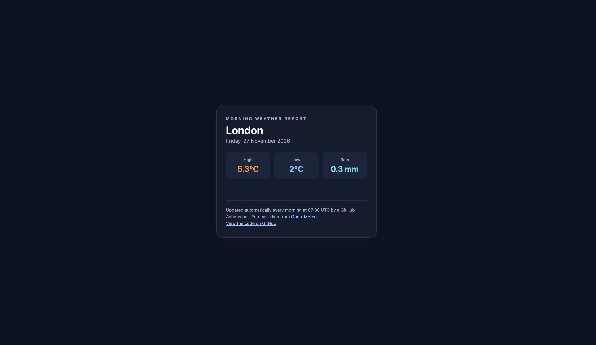

# Morning Weather Bot

A small automation that fetches London's weather forecast every morning and saves it as a report in this repo. A scheduled GitHub Actions workflow runs a Node.js script, which calls a free weather API, writes the result to `weather.md`, and commits it back automatically. A small web page then shows the latest report. Nothing to host yourself and no API key needed.

**Live page:** <https://ademola-o.github.io/morning-weather-bot/>

**Latest report:** [`weather.md`](weather.md)

**Image of bot**


## What it produces

Every day the script overwrites `weather.md` with a short report in this format (example values):

```
# Morning weather report
Date: 2026-11-27
High: 9.4°C
Low: 4.1°C
Rain: 0.6 mm
```

## How it works

1. **The schedule.** A `cron` trigger (`0 7 * * *`) starts the workflow every day at 07:00 UTC.
2. **A fresh machine.** GitHub starts a temporary Ubuntu machine, downloads this repo and installs Node.js.
3. **The script.** `weather.js` builds a request to the [Open-Meteo](https://open-meteo.com) forecast API, asking for London's highest temperature, lowest temperature and total rainfall for today.
4. **The reply.** It checks the request succeeded, turns the JSON reply into a JavaScript object, and checks the data has the shape it expects.
5. **The report.** It writes a short Markdown report to `weather.md`.
6. **Saving it.** The workflow commits `weather.md` and pushes it back to the repo. If nothing changed, it skips the commit instead of failing.

## Project structure

```
morning-weather-bot/
├── .github/
│   └── workflows/
│       └── weather.yml    The schedule and the steps GitHub runs
├── css/
│   └── style.css          Styling for the web page, with an automatic dark theme
├── js/
│   ├── main.js            Fetches weather.md and fills in the page
│   ├── report.js          Reads and formats the report (no page code, fully tested)
│   └── package.json       Marks the files in this folder as ES modules
├── tests/
│   └── report.test.mjs    Automated tests for report.js
├── index.html             The web page (structure only)
├── weather.js             The bot: fetches the forecast and writes the report
├── weather.md             The latest report (updated automatically)
├── .nojekyll              Tells GitHub Pages to serve the files as they are
└── README.md
```

## Running it

**On GitHub (the normal way).** It runs by itself every morning. To run it on demand, open the **Actions** tab, choose **Morning weather**, and click **Run workflow**.

**On your own computer.** You need [Node.js](https://nodejs.org) 18 or newer, which includes the built-in `fetch`.

```
node weather.js
```

## The web page

`index.html` is hosted with GitHub Pages and shows the latest report as a card with the date, the high, the low and the rain. It reads `weather.md` each time it loads, so it updates itself whenever the bot commits a new report. If the report is two or more days old, the page says so, in case the bot has stopped running.

- It follows the visitor's light or dark setting, works on phones, and shows a clear message if the report can't be loaded.
- It needs a web server to read `weather.md`, so opening `index.html` by double-clicking won't show any data. Use the live page, or the VS Code **Live Server** extension.
- To host it: **Settings → Pages → Deploy from a branch → `main` → `/ (root)`**, and keep the `.nojekyll` file in the main folder.

## Running the tests

Needs [Node.js](https://nodejs.org) 18 or newer. Nothing to install.

```
node --test
```

The tests cover reading the report, handling bad or incomplete input, validating dates, and working out how old a report is, including across the clocks changing.

## Customising it

- **Another city:** change `LAT` and `LON` at the top of `weather.js`, and the `timezone` value in the URL.
- **Another time:** change the `cron` line in `weather.yml`. The five fields are minute, hour, day of month, month and day of week. GitHub uses **UTC**, so `0 7 * * *` is 7am in the UK in winter and 8am in summer.
- **More data:** add more values to the `daily=` part of the URL, such as `wind_speed_10m_max`, and add them to the report.

## Design decisions

- **Failures are never silent.** If the API returns an error, doesn't answer within 10 seconds, or sends back something unexpected, the script exits with code 1. That makes the GitHub run show a red cross, and the previous report is left untouched.
- **Least privilege.** The workflow is only given `contents: write`, the one permission it needs to push the report, and nothing else.
- **No secrets.** Open-Meteo is free for non-commercial use and needs no API key, so there is nothing sensitive in the repo. If a key were needed, it would go in GitHub Secrets, never in the code.
- **Safe to run repeatedly.** `git commit ... || echo "No changes"` means a day with no changes doesn't fail the run, and `git pull --rebase` before the push avoids rejected pushes.
- **Logic is separate from the page.** `js/report.js` has no page code in it, so it can be tested on its own. `js/main.js` connects it to the page.
- **The page is honest about old data.** If the report is two or more days old, it says so instead of presenting it as fresh.
- **User-facing text is added with `textContent`,** never `innerHTML`, so nothing in the report file can run as code.
- **ES modules only where needed.** `js/package.json` makes the files in `js/` modules without affecting `weather.js`, which the bot runs as a normal Node.js script.
- **`.nojekyll`** stops GitHub Pages converting `weather.md` into an HTML page, so the page can read the raw file.
- **Manual trigger.** `workflow_dispatch` adds a Run button, so changes can be tested without waiting until morning.

## Known limitations

- It reports one city and one day.
- GitHub scheduled runs can start a few minutes late when it's busy. GitHub can also pause scheduled workflows in a repo with no activity for 60 days, so if the reports stop, check the Actions tab.
- Each run adds a commit, so the history grows by one entry a day.
- The report is only saved as a file. It isn't sent anywhere.

## Ideas for next steps

- [ ] Send the report by email, Telegram or Discord
- [ ] Add wind speed and a weather description
- [ ] Choose the city from a setting instead of editing the code
- [ ] Link the live page from my portfolio site
- [ ] Update the workflow to a newer Node.js version

## What I learned

- What an API is, and how query parameters ask for specific data
- Reading JSON and using `async` / `await` to wait for a reply
- Handling errors, timeouts and unexpected replies, and using exit codes
- Scheduling with cron syntax
- Writing a GitHub Actions workflow: triggers, permissions, jobs and steps
- Giving automation only the permissions it needs
- Committing to a repo from inside an automated job
- Reading a file from a web page with `fetch`, and handling failures
- Splitting code into ES modules, with logic kept separate from the page
- Writing automated tests with Node's built-in test runner
- Hosting a static site with GitHub Pages

## Author

Ademola Okesanjo ([GitHub](https://github.com/Ademola-O) · [LinkedIn](https://www.linkedin.com/in/ademola-o-400802130/))
